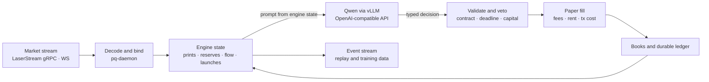

<div align="center">

# pump-quant

**Model-directed trading research for Solana memecoin markets, with a deterministic Rust engine underneath.**

[Status](#status) · [How it works](#how-it-works) · [AI/ML approach](#aiml-approach) · [Get started](#get-started-offline) · [Docs](#documentation) · [For coding agents](#for-coding-agents)

</div>

pump-quant watches pump.fun bonding curves and PumpSwap pools and asks a fine-tuned Qwen model what to do: enter, watch,
skip, or manage an open position. A Rust engine checks each answer against the account and market, simulates the fill,
and books every lamport, so each decision can be measured against its real costs.

> [!NOTE]
> The current release runs in **paper mode** only. Orders are simulated against observed market state, and nothing
> is submitted on-chain.

## Status

| Area | Where it stands |
|---|---|
| Engineering | **Accepted** at a pinned source revision: CI, workspace tests and a packaged stop → report → restore drill. [Record](docs/acceptance/ENGINEERING_ACCEPTANCE.md) |
| Model quality | **Not accepted.** No checkpoint has passed the decision-quality gates, and none is promoted. |
| Serving latency | Engine-side timely usability (≥ 95 % of decisions usable before their deadline) is **not yet demonstrated**. |
| Forward paper evaluation | **Not yet run.** It will measure operational behaviour and net economics over a bounded window. It cannot establish sustained profitability. |
| Live trading | **Not enabled.** Several independent gates are closed. See [Operating boundaries](#operating-boundaries). |

Dated results live in the linked records, not on this page.

## How it works



1. **Observe.** The daemon decodes on-chain transactions and account updates into prints, reserves and launches. It
   keeps causal state per market: only information available at decision time is used.
2. **Decide.** For a candidate market or an open position, the engine renders a fixed-format prompt from its own
   state. Qwen answers with an action and a size tier.
3. **Validate.** Rust parses the answer against the contract. It refuses late, malformed or off-contract answers by
   name, and applies capital vetoes. It never substitutes a decision the model did not make.
4. **Fill and reconcile.** Paper fills are priced on the market state observed after the decision, including venue
   fees, rent deposits and transaction costs. Settlement updates books, the held-position ledger and the sealed event
   capture, so a restart resumes from the same state.

<details>
<summary>Decision vocabulary</summary>

| Context | Actions | Size |
|---|---|---|
| Entry | `BUY`, `WATCH`, `SKIP` | `SMALL` or `FULL` on `BUY`, otherwise `NONE` |
| Open position | `HOLD`, `ADD`, `REDUCE`, `EXIT` | fraction defined by the management contract |

`SMALL` and `FULL` are fractions of the account's clip: 25 % and 100 % while the portfolio cap is enforced, and a
uniform 50 % otherwise (see [Operating boundaries](#operating-boundaries)). The model chooses the tier. The engine
resolves the lamport amount.
</details>

## AI/ML approach

**Data.** A capture sidecar records the raw stream. The same decoders the daemon uses turn it into causal features:
windows end at the decision time, and fields that are unknown stay unknown. Data pipelines and the training code of
record live under `tools/data-pipeline`, `tools/training` and `training/`.

**Prompts, labels and evaluation sets** are versioned contracts. The prompt and response formats are defined in
`pump-quant-proposal` and parsed by `pump-quant-inference`. Training, validation and held-out examination sets are
kept separate, and held-out rows are excluded from training. Dataset pins and run records live with the training
code of record.

**Training.** Qwen is adapted with supervised fine-tuning and offline RL experiments. Runs are pre-registered with
pass/fail criteria. Low loss or a passing format check shows the model learned the contract; it does not show
economic edge.

**From checkpoint to serving.** These are three different states:

- **Trained checkpoint:** the output of a run.
- **Accepted model:** a checkpoint that passed the pinned decision-quality and serving gates.
- **Promoted serving configuration:** an accepted model deployed behind vLLM by an operator decision.

The daemon can be pointed at any served checkpoint. Diagnostic runs, used to measure serving, latency and contract
behaviour, have used unaccepted checkpoints, and their results say nothing about decision quality. An authorized
forward paper run requires an accepted, promoted configuration. Today no checkpoint is accepted.

**No online learning.** The system does not learn from its own trades. Paper and live outcomes become data only
through an explicit, versioned dataset build and a new training run.

## Operating boundaries

**Qwen** decides the action and the size tier.

**Rust** decides feasibility and keeps the books. It handles prompt construction, the response contract, deadlines,
fills, fees, rent, settlement and the durable ledger. It also runs the agreed safeguards (hard stop, rug precursor,
the SAFETY_OFF latch, the stop/handoff contract), which act on held positions without asking the model.

**Capital sizing.** The model's tier is resolved to lamports by Rust.

- With the portfolio cap enforced, `SMALL` is 25 % and `FULL` is 100 % of the configured clip.
- If the portfolio cap cannot be counted live, a uniform half-clip fallback applies to every tier. This lowers
  `FULL` to 50 %, but **raises `SMALL` from 25 % to 50 %**. That is a known policy limitation, recorded in the
  [acceptance record](docs/acceptance/ENGINEERING_ACCEPTANCE.md). It is not changed here.
- The resulting clip is capped to what the account can pay after a fee buffer, and refused below the venue minimum.
- An entry is refused if it would cross the bankroll survival floor, exceed the own-impact limit on the pool, or
  exceed the portfolio and per-position caps.
- Anything off-contract means no trade.

Exact values live in the configuration file (see [Documentation](#documentation)).

**Live trading is not available in this release.** Several independent gates are closed:

- The model admission path refuses every decision in live mode (`refuse:live_forbidden`).
- The live BUY builder refuses with `deposit_unknown` until a coherent on-chain state fetcher exists.
- Signing keys are operator-held and are not part of any quick start.

Fixing any one of these alone does not enable trading. Deployed program metadata has been read, including the last
deploy slot and upgrade authority. Still open:

- the executable behaviour of some account-creation paths the builder relies on;
- re-reading program metadata at runtime;
- the behaviour of historical program versions.

## Get started (offline)

You need Linux x86-64, Rust stable (tested with 1.99.0) and Python 3. The first build downloads crates. For a fully
offline build, the dependencies must already be cached or vendored; then add `--offline`.

```bash
git config core.hooksPath .githooks              # blocking credential guard, once per clone
python3 tools/gates/portable_gate.py --repo .    # → "portable gate PASSED (blocking checks)"

cd rust
cargo test --workspace --locked                  # → every target reports "0 failed"
```

To replay a recorded event stream through the engine, you need an input file. None is committed. A paper session
writes one to `data/event_stream.jsonl`.

```bash
cargo run --locked --bin pq-engine-replay -- --event-stream <event_stream.jsonl> --config data/CHAMPION_CONFIG.txt
# → one JSON line: {"admitted":…,"rejected":…,"net_lamports":…,"ticks":…,"events_fed":…,"parse_skipped":0}
```

The output counts engine decisions on that input. It is not a performance result.

<details>
<summary>Full CI-equivalent checks and paper daemon notes</summary>

```bash
cd rust
cargo fmt --all -- --check
cargo clippy --workspace --all-targets --locked -- -D warnings
cargo build --workspace --locked
cargo test --workspace --locked
```

A paper `pq-daemon` session needs **stream/API credentials** (Helius / LaserStream) and, for model decisions, a
reachable model endpoint (`PQ_MODEL_ENDPOINT`). It needs **no signing key**. At start it prints
`startup paper check: no keypair, no --live, no submission sink (paper)`. See [`docs/ENTRY.md`](docs/ENTRY.md) §5
and §10. These daemon steps were not executed while writing this page.
</details>

## Documentation

| Topic | Where |
|---|---|
| Operating entry, binaries, environment, stop sentinels, retired features | [`docs/ENTRY.md`](docs/ENTRY.md) |
| Engineering acceptance, release identities, rollback | [`docs/acceptance/ENGINEERING_ACCEPTANCE.md`](docs/acceptance/ENGINEERING_ACCEPTANCE.md) |
| Branch dispositions | [`docs/acceptance/BRANCH_CLEANUP_RECORD.md`](docs/acceptance/BRANCH_CLEANUP_RECORD.md) |
| Consolidation history | [`docs/CONSOLIDATION_MANIFEST.md`](docs/CONSOLIDATION_MANIFEST.md) |
| Training code of record | [`training/README.md`](training/README.md) |
| Runtime configuration | `rust/data/CHAMPION_CONFIG.txt` |

Many files in `docs/` describe earlier designs and launch procedures. They are kept as history, not instructions.
Where they disagree with `docs/ENTRY.md`, that file wins.

## For coding agents

<details>
<summary>Canonical locations, validation and working rules</summary>

**Code**

- Engine: `rust/crates/pump-quant-app` (model lane, positions, paper fills, fees, rent, tx cost, safeguards, durable state).
- Daemon and binaries: `rust/crates/pump-quant-junction` (`src/bin/pq_daemon.rs`, stream decode, restart rehydration).
- Model contract: `rust/crates/pump-quant-proposal` (prompt/response format) and `rust/crates/pump-quant-inference` (`src/seam.rs` parser and decision types).
- On-chain layouts and deposit planning: `rust/crates/pump-quant-protocol`, `rust/crates/pump-quant-execution`.

**Configuration and cost assumptions**

- `rust/data/CHAMPION_CONFIG.txt`, including `txcost_version` and `paper_rent_basis`.
- Definitions: `pump-quant-app/src/txcost.rs`, `pump-quant-app/src/paper_deposit.rs`, `pump-quant-junction/src/builder_txcost.rs`.

**Validation.** Run the commands in the CI-equivalent block above. CI is `.github/workflows/gate.yml` (`rust-ci`, on
pull requests to `main`).

**Release identities.** Accepted source revision, packaged binary hashes and rollback SHA are in
`docs/acceptance/ENGINEERING_ACCEPTANCE.md`. A later documentation or merge commit is not the source of a built
binary.

**Working rules**

- Preserve journals, datasets, checkpoints, capture files and other people's uncommitted work.
- Never delete, clean, rewrite or force-push to make a tree look tidy.
- Missing evidence is a named refusal, not a default.
- Approval boundaries are set by the operator's instructions and `docs/ENTRY.md` §3–§4, not by this README. A
  passing test run grants no authority to trade, promote a model or change policy.
</details>

---

<sub>Trading memecoins carries a high risk of total loss. Nothing here is financial advice or a claim of profitability.</sub>
